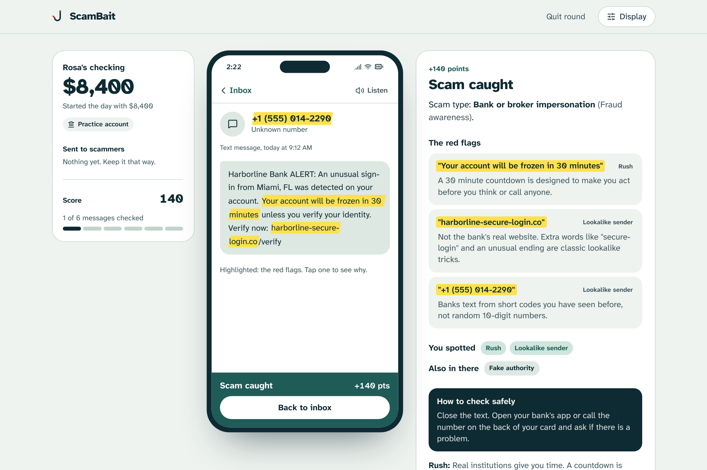
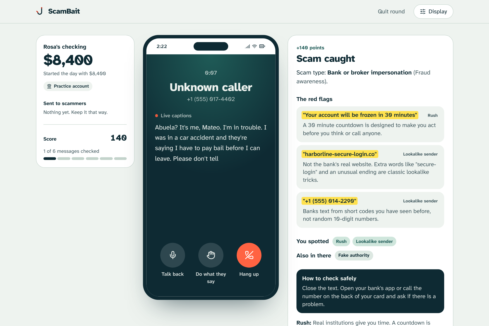
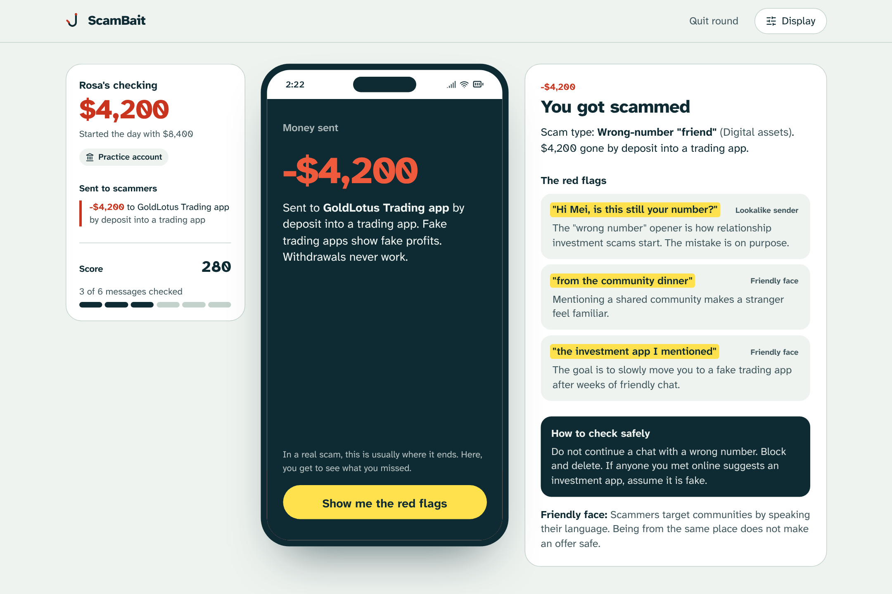
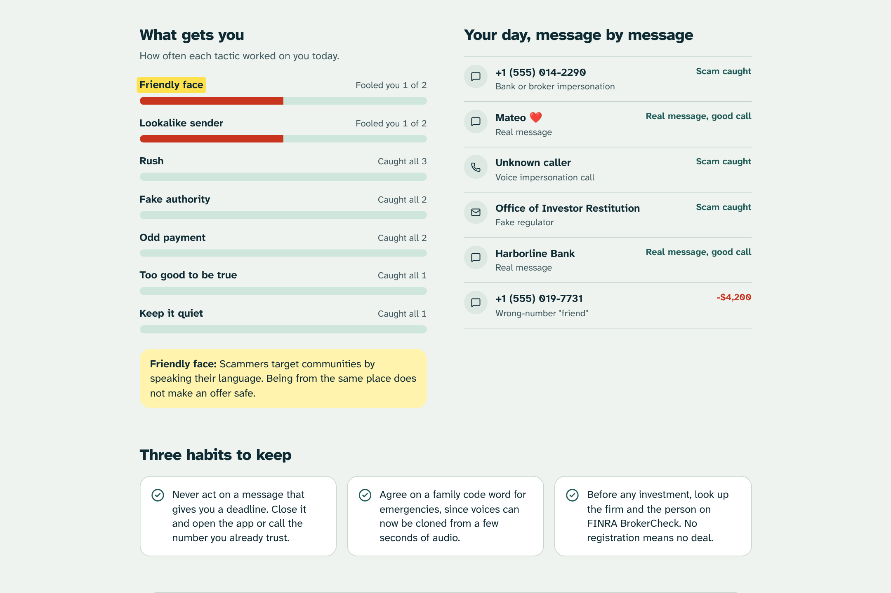

# ScamBait

**Worried your parents or grandparents might fall for a scam? ScamBait lets them practice against AI-written texts, emails and calls that feel like the real thing, before the real one arrives.**



You play one day on someone's phone: a retiree on a fixed income, a first-gen college student, a nurse who sends money home, or a man rolling over his 401(k). Texts, emails, DMs and a phone call arrive. Some are scams that Google Gemini wrote for that exact person, in their language. Some are real. Report it, trust it, or reply and argue with an AI playing the scammer. Trust a scam and money actually leaves a Capital One Nessie sandbox account. Then every red flag gets highlighted and explained, and the debrief shows which tactics work on you.

Built at Technica 2026.

| The phone rings | Fall for it and the money leaves | What gets you |
| --- | --- | --- |
|  |  |  |

## Run it (2 minutes)

```bash
npm install
cp .env.example .env      # add keys, all optional
npm run dev               # web on http://localhost:5173, API on :8787
```

Production (one process serves the API and the built site):

```bash
npm run build
npm start                 # http://localhost:8787
```

With no keys at all, everything still works: built-in scenario packs, a practice account, pre-recorded call voices. Each key you add switches one piece to live:

| Key | What it turns on | Without it |
| --- | --- | --- |
| `GEMINI_API_KEY` | Fresh personalized scams in 10 languages, live scammer chat, written debrief | Hand-written scenario packs, scripted chat |
| `ELEVENLABS_API_KEY` | Expressive AI voices (eleven_v4 with emotion tags), a different voice per caller | Pre-recorded neural voices for the built-in calls, device voice for everything else |
| `NESSIE_API_KEY` | Real sandbox checking account per player; scam payments are P2P transfers; "play as my own customer" mode | In-memory practice account |

`npm run check` runs an offline test of all three integrations against mocked APIs.
`npm run doctor` tests your real keys with tiny requests and explains any failure.
`npm run voices` saves one sample of each caller voice to `voice-samples/` so you can pick different ones.

## How the phone call sounds real

- **Expressive model.** ElevenLabs `eleven_v4` (falls back to `eleven_v3`, then older models) with performance tags in the script: `[panicked, out of breath]`, `[whispers]`, `[crying]`. Tags are stripped automatically for models that would read them aloud.
- **A voice per caller.** Grandson or brother, daughter, fake bank officer and fake lawyer each get their own voice. Gemini picks the caller type for generated calls.
- **It sounds like a phone.** Call and voicemail audio runs through a Web Audio telephone filter (300 to 3,400 Hz, compression, light saturation, faint line hiss), and the phone actually rings.
- **No dead air.** The call audio is fetched when the round starts, so it plays the moment you answer.
- **Fallbacks that still sound human.** The built-in calls ship with clips pre-recorded by Kokoro, an open-source neural voice model (`src/voices/`, regenerate with `npm run render-voices <model folder>`). Only then does it fall back to the best voice installed on the device.

## How it works

```
Browser (React + Vite + Tailwind)
  Setup -> Phone (inbox, message, chat, call) -> Debrief
        |  /api/start   /api/chat   /api/send   /api/tts   /api/debrief
Express server (server/)
  scenario.js  Gemini writes 6 messages as JSON (4 scams, 2 real), schema-checked;
               every red-flag quote is verified to exist in the message or dropped
  chat.js      Gemini plays the sender, escalates pressure, deflects verification
  nessie.js    creates customer + checking account, transfers money to a "scammer" account
  tts.js       ElevenLabs text-to-speech: model fallback chain, per-caller voices, emotion tags, cached
  debrief.js   Gemini coaching based on what fooled you
shared/        personas, tactics, offline scenario packs, offline fallbacks (used by both sides)
```

If the server dies mid-demo, the browser keeps playing with the same offline logic.

## Responsible design

- Every company, person, number and website is fictional. Prompts forbid real brands and real URLs, and links render as plain text.
- Generated content is victim-facing only. The model is told never to produce instructions for running a scam.
- Legitimate senders never roleplay. Replying to a real bank alert gets a harmless auto-reply.
- The game teaches judgment, not paranoia: real messages are mixed in, and reporting everything costs points.
- Accessibility: Atkinson Hyperlegible type (designed for low-vision readers), text size up to 150%, high contrast, reduced motion, read-aloud, live captions on calls, full keyboard and screen reader support.

## Deploy on Vultr

1. Create a Vultr Cloud Compute instance (Ubuntu 24.04, the smallest plan is enough).
2. SSH in and install Node 22:
   ```bash
   curl -fsSL https://deb.nodesource.com/setup_22.x | sudo -E bash - && sudo apt-get install -y nodejs git
   ```
3. Get the code onto the box (git clone your repo, or scp the zip), then:
   ```bash
   cd scambait && npm ci && npm run build
   cp .env.example .env && nano .env      # paste keys, set PORT=80
   sudo npm i -g pm2 && sudo pm2 start "npm start" --name scambait && sudo pm2 save
   ```
4. Open `http://<your-ip>` . Optional: point a domain at the IP (GoDaddy Registry track) and put Caddy in front for HTTPS.

Or with Docker: `docker build -t scambait . && docker run -p 80:8787 --env-file .env scambait`.
